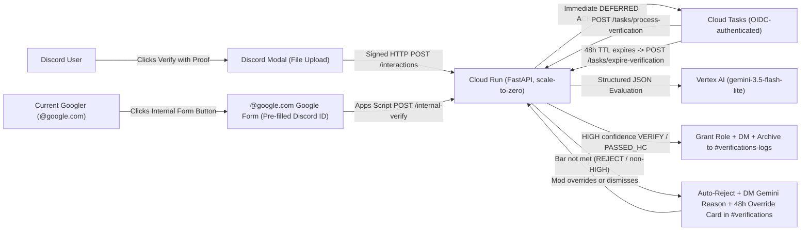

# Googlers Discord Verification Bot

A serverless, zero-privileged-intent Discord verification bot for the **Googlers Discord server**, built on **Cloud Run + Cloud Tasks + Vertex AI (`gemini-3.5-flash-lite`)** and managed via **Terraform** and **GitHub Actions CI/CD** for **~ \$0/month** (well under a \$1/month billing alert).

## Architecture



### Why this design stays reliable and near \$0/month
- **Zero Privileged Intents:** Uses Discord's HTTP Interactions Endpoint and native Modal File Upload (`Label` + `File Upload`) so the bot gets each user's exact numeric `user.id` directly — no `GUILD_MEMBERS`, `MESSAGE_CONTENT`, or `GUILD_PRESENCES` intents required, and no annual 10,000-member Discord compliance reviews.
- **No 24/7 VM:** Scale-to-zero Cloud Run (`min=0`, `max=3`) fits comfortably inside GCP's Always Free tier (2M requests/month).
- **No Prepaid AI Credits to Expire:** Uses Vertex AI (`gemini-3.5-flash-lite`, `global`) authenticated via Cloud Run's service account (ADC), billed on-demand at pennies/month under a hard **\$1/month** GCP billing budget alert.
- **No Hidden Storage Costs:** Artifact Registry cleanup policy retains only the 2 most recent container images (< 0.5 GB Always Free tier), and Secret Manager stores a single packed JSON secret (1 active version out of 6 free).
- **Keyless CI/CD:** GitHub Actions deploys merges on `main` using GCP Workload Identity Federation locked strictly to `refs/heads/main` — zero static JSON service account keys.

## Features
- **In-Discord Proof Upload Modal:** Accepts 1–2 screenshots or PDFs (up to 10 MB each) plus optional context; skips already-verified users.
- **Structured AI Verification:** Evaluates proof against explicit criteria (`VERIFY`, `PASSED_HC`, `REJECT`), hardened against prompt injection. Auto-approves on `HIGH`-confidence `VERIFY` / `PASSED_HC`, and **auto-rejects by default** with Gemini's justification sent directly to the user when the bar isn't met (while still falling back to manual review if Vertex AI itself errors).
- **48-Hour Mod Override Window + 1-Click Buttons:** Auto-rejected submissions are archived to `#verifications-logs` and also posted to `#verifications` with Gemini's reasoning, proof attachment, and **`[✅ Override: Verify]` `[🟡 Override: Passed HC]` `[❌ Reject w/ Note]` `[🗑️ Dismiss]`** buttons. A scheduled Cloud Task automatically deletes the `#verifications` card after 48 hours (`AUTO_REJECT_TTL_HOURS`) if no mod overrides or dismisses it first.
- **Slash Commands:** `/verify`, `/passed_hc`, `/reject`, and `/setup_panel` (all gated by `MANAGE_ROLES`).
- **Internal `@google.com` Form Endpoint (`/internal-verify`):** Pre-filled Google Form link passes each Googler's exact Discord User ID for instant verification (`scripts/internal_form_apps_script.gs`).

## Local Development & Testing

```bash
python3 -m venv .venv
source .venv/bin/activate
pip install -r requirements-dev.txt

ruff check app tests scripts
pytest --cov=app --cov-report=term-missing
```

## Infrastructure (Terraform)

All GCP infrastructure is defined in `infra/` with remote state stored in GCS (`gs://discord-verify-bot-jafer-tfstate`, Always Free tier):

```bash
cd infra
terraform init
terraform plan
terraform apply
```

Secret values (`DISCORD_BOT_TOKEN` and `INTERNAL_FORM_SECRET`) are stored in GCP Secret Manager (`bot-secrets`) outside Terraform state. To rotate the Discord bot token safely without leaving extra active secret versions:

```bash
./scripts/set_bot_token.sh
```

## Admin Utilities
- `scripts/register_commands.py` — Register/update guild slash commands.
- `scripts/set_bot_token.sh` — Safely rotate `DISCORD_BOT_TOKEN` in Secret Manager, roll Cloud Run, and re-register commands.
- `scripts/internal_form_apps_script.gs` — Google Apps Script for the internal `@google.com`-restricted Google Form.
- `scripts/backfill_verifications.py` — One-time/ad-hoc backfill tool for legacy webhook verification messages (`--dry-run` by default; pass `--apply` to execute).
